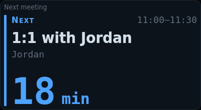
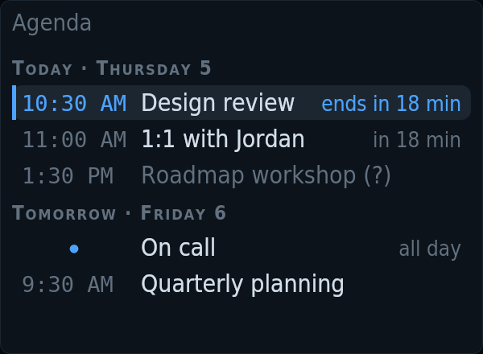
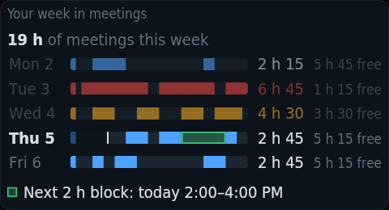

# kiosko-plugin-calendar

Meetings from published ICS calendars (Outlook/Teams, Google…): a countdown to the next one, the agenda of the next days and how full your week is.

A plugin for [Kiosko](https://github.com/kiosko-lcd/kiosko), the widget mosaic for small USB LCD panels.



## Install

In Kiosko, **Plugins → Install from npm** → `kiosko-plugin-calendar`, then restart Kiosko. Or from a terminal:

```sh
npm install --prefix ~/.config/kiosko/plugins kiosko-plugin-calendar
```

(macOS: `~/Library/Application Support/Kiosko/plugins`, Windows: `%APPDATA%\Kiosko\plugins`.)

## Requirements

- The ICS address of a published calendar (Outlook: *Settings → Calendar → Shared calendars → Publish*; Google: *Secret address in iCal format*). Treat it as a password.

## What it does on your machine

- **Internet**: contacts the ones you set in its options.

## Widgets

### Next meeting — `calendar/next`

A big countdown to your next meeting. Its colour climbs the semaphore as it nears, and it takes the tile over when it’s about to start.


Uses: `calendar/events`.

| Option | Type | Default | |
|---|---|---|---|
| `showTitle` | boolean | `true` | Show the title. Off: only the time and the countdown. Private meetings never show it. |
| `showAttendees` | boolean | `true` | Show who attends. With the title. Outlook’s published calendars don’t carry them. |
| `greyMs` | duration (ms) | `7200000` | Awake from (before it starts). Further away it is drawn dim and lets the panel sleep. |
| `readyMs` | duration (ms) | `1800000` | Info colour from (before it starts) |
| `warnMs` | duration (ms) | `600000` | Warning colour from (before it starts). Also when, back to back, the next meeting replaces the one under way. |
| `alertMs` | duration (ms) | `180000` | Alert from (before it starts). From here until it ends, it takes its tile over. |
| `hideTentative` | boolean | `false` | Skip tentative meetings. Invitations not accepted yet. |
| `calendars` | list | `[]` | Calendars. Empty: all. Names as each calendar calls itself (Work, Holidays…), comma-separated; * matches anything, a leading ! leaves out. |

### Agenda — `calendar/agenda`

The meetings left today and those of the next days: the one under way highlighted, the next one with its countdown.



Uses: `calendar/events`.

| Option | Type | Default | |
|---|---|---|---|
| `days` | number | `2` | Days. Today included: 1 is only today, 2 today and tomorrow. The source must look as many days ahead, minus one. |
| `showTitle` | boolean | `true` | Show the titles. Off: "Meeting" instead, for a screen others see. Private meetings never show theirs. |
| `rows` | number | `0` | Rows. 0 = as many as fit. A number shows that many, in rows of a readable size (fewer when the tile is too small for them); the rest are counted in "+N more". |
| `calendars` | list | `[]` | Calendars. Empty: all. Names as each calendar calls itself (Work, Holidays…), comma-separated; * matches anything, a leading ! leaves out. |
| `greyMs` | duration (ms) | `7200000` | Awake from (before it starts). With no meeting this close, it lets the panel sleep. |
| `warnMs` | duration (ms) | `600000` | Warning colour from (before it starts). From here the card takes its tile over. |
| `alertMs` | duration (ms) | `180000` | Alert colour from (before it starts) |
| `holdMs` | duration (ms) | `600000` | Keep the tile after a start. Once you know where you are, the tile goes back to its rotation. |

### Your week in meetings — `calendar/week-load`

Meeting hours against free hours on each working day of the week, the busiest days in amber or red, the next free block long enough for deep work, and the week’s total.



Uses: `calendar/events`.

| Option | Type | Default | |
|---|---|---|---|
| `days` | `week` \| `rest` \| `next5` | `"week"` | Days. The working days and hours of Settings → Work hours; holidays are days off. Once the week’s work is over, the whole week and its rest are the coming one. The source must look as many days ahead. |
| `blockMs` | duration (ms) | `7200000` | Free block to look for. The next stretch without meetings at least this long, within work hours: for deep work. |
| `warnPercent` | number | `50` | Amber from. Share of the day’s work hours in meetings. |
| `alertPercent` | number | `75` | Red from. Share of the day’s work hours in meetings. |
| `hideTentative` | boolean | `false` | Don’t count tentative meetings. Invitations not accepted yet. All-day events and those marked free never count. |
| `calendars` | list | `[]` | Calendars. Empty: all. Names as each calendar calls itself (Work, Holidays…), comma-separated; * matches anything, a leading ! leaves out. |

Meeting time is the time inside each day's work hours (Kiosko → Settings → Work hours) taken by at least one meeting: two meetings at the same hour count once; all-day events, events marked free and declined meetings (Outlook keeps them as free, or drops them) don't count; holidays are days off. Each day is a strip of its work hours on a common time axis, with its meetings filled in and the next free block outlined.

## Data sources

### Calendar meetings — `calendar/events`

Meetings of this week and the next days from one or more published calendars (ICS). Free and focus-time events are left out, and all-day ones unless you ask for them. Read every 5 min while a widget uses it. Options are set once in Kiosko → Settings → Data sources.

| Option | Type | Default | |
|---|---|---|---|
| `urls` | list | `[]` | Calendars (ICS addresses). The secret address of a published calendar (Outlook on the web: Settings → Calendar → Shared calendars → Publish a calendar → ICS). Anyone with it can read your agenda: treat it like a password. |
| `ignore` | list | `["focus time","tiempo de concentración"]` | Ignore titles containing. Busy blocks that are not meetings, like focus time. Case and accents don’t matter. |
| `horizonDays` | number | `6` | Days ahead. Besides today. The agenda shows as many days as this plus one, at most. |
| `includeAllDay` | boolean | `false` | Include all-day events. Holidays, trips, on-call days: listed at the top of their day in the agenda. They never count as the next meeting. |

## Development

```sh
npm install
npm test          # node:test
npm run check     # TypeScript
npm run build     # dist/index.js, what Kiosko loads
```

To try it in a running Kiosko without publishing: `kiosko plugins link .` and restart Kiosko.

Working on Kiosko and its plugins together: clone them side by side
(`kiosko/` and `kiosko-plugins/kiosko-plugin-calendar/`) and run `npm install` in
`kiosko/`; its workspaces link every plugin found in `../kiosko-plugins`.

## License

MIT
