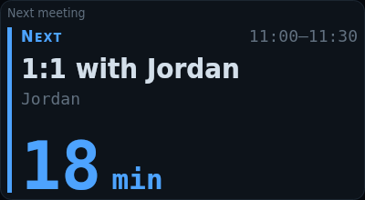
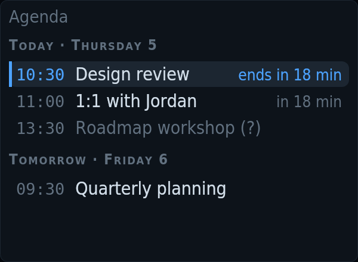

# tessera-plugin-calendar

Meetings from published ICS calendars (Outlook/Teams, Google…): a countdown to the next one and the agenda of today and tomorrow.

A plugin for [Tessera](https://github.com/Loksly/tessera), the widget mosaic for small USB LCD panels.



## Install

In Tessera, **Plugins → Install from npm** → `tessera-plugin-calendar`, then restart Tessera. Or from a terminal:

```sh
npm install --prefix ~/.config/tessera/plugins tessera-plugin-calendar
```

(macOS: `~/Library/Application Support/Tessera/plugins`, Windows: `%APPDATA%\Tessera\plugins`.)

## Requirements

- The ICS address of a published calendar (Outlook: *Settings → Calendar → Shared calendars → Publish*; Google: *Secret address in iCal format*). Treat it as a password.

## Widgets

### Next meeting — `calendar/next`

A big countdown to your next meeting. Its colour climbs the semaphore as it nears, and it takes the tile over when it’s about to start.


Uses: `calendar/events`.

| Option | Type | Default | |
|---|---|---|---|
| `showTitle` | boolean | `true` | Show the title. Off: only the time and the countdown. Private meetings never show it. |
| `greyMin` | number | `120` | Awake from (min before). Further away it is drawn dim and lets the panel sleep. |
| `readyMin` | number | `30` | Info colour from (min before) |
| `warnMin` | number | `10` | Warning colour from (min before) |
| `alertMin` | number | `3` | Alert from (min before). From here until it ends, it takes its tile over. |

### Agenda — `calendar/agenda`

Today’s remaining meetings and tomorrow’s: the one under way highlighted, the next one with its countdown.



Uses: `calendar/events`.

| Option | Type | Default | |
|---|---|---|---|
| `tomorrow` | boolean | `true` | Tomorrow too. Needs 1 or more days ahead in the source. |
| `warnMin` | number | `10` | Warning colour from (min before). From here the card takes its tile over. |
| `alertMin` | number | `3` | Alert colour from (min before) |
| `holdMin` | number | `10` | Keep the tile after a start (min). Once you know where you are, the tile goes back to its rotation. |

## Data sources

### Calendar meetings — `calendar/events`

Meetings of today and the next days from one or more published calendars (ICS). All-day, free and focus-time events are left out. Read every 5 min while a widget uses it. Options are set once in Tessera → Settings → Data sources.

| Option | Type | Default | |
|---|---|---|---|
| `urls` | list | `[]` | Calendars (ICS addresses). The secret address of a published calendar (Outlook on the web: Settings → Calendar → Shared calendars → Publish a calendar → ICS). Anyone with it can read your agenda: treat it like a password. |
| `ignore` | list | `["focus time","tiempo de concentración"]` | Ignore titles containing. Busy blocks that are not meetings, like focus time. Case and accents don’t matter. |
| `horizonDays` | number | `1` | Days ahead. Besides today. The agenda needs at least 1 to show tomorrow. |
| `timeoutMs` | duration (ms) | `20000` | Download timeout |

## Development

```sh
npm install
npm test          # node:test
npm run check     # TypeScript
npm run build     # dist/index.js, what Tessera loads
```

To try it in a running Tessera without publishing: `tessera plugins link .` and restart Tessera.

Working on Tessera and its plugins together: clone them side by side
(`tessera/` and `tessera-plugins/tessera-plugin-calendar/`) and run `npm install` in
`tessera/`; its workspaces link every plugin found in `../tessera-plugins`.

## License

MIT
